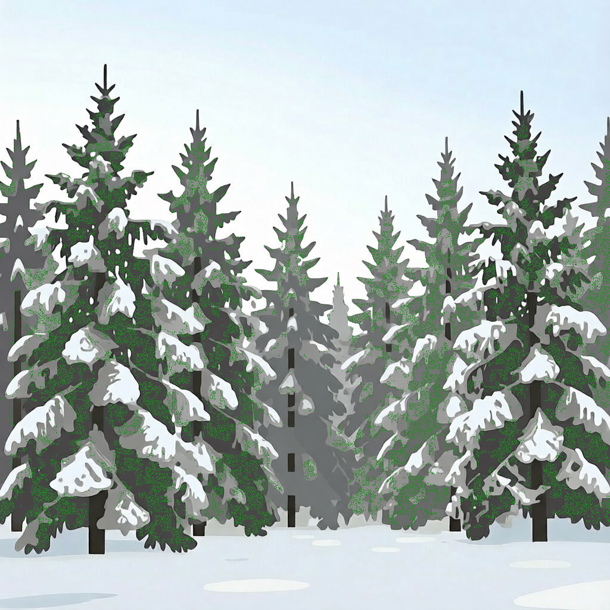

# Пробуждение Весны

| Характеристика | Значение |
| --- | --- |
| **Категория** | Классная работа |
| **Макс. балл** | 14 |
| **Ограничение времени** | 1.2 секунды |
| **Ограничение памяти** | 64 Мб |
| **Ввод** | winter.png |
| **Вывод** | spring.png |
| **ID задачи** | `94973` |

---

## Условие

Белая Колдунья заморозила поляну. В файле **winter.png** находится чёрно-белое изображение леса. Весна хочет раскрасить 30% умеренно серых пикселей в зеленый цвет.

Найдите все серые пиксели (серые — это те, у которых все три компоненты цвета одинаковы) со значением компонент цвета от 50 до 200 включительно, выберите из них случайно 30% и окрасьте в зелёный `(34, 139, 34)`.

Сохраните в файл **spring.png**.

### Пример файла winter.png

### Результат в файле spring.png

