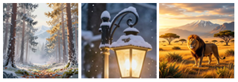

# Фотоархив Нарнии

| Характеристика | Значение |
| --- | --- |
| **Категория** | Домашняя работа |
| **Макс. балл** | 25 |
| **Ограничение времени** | 1 секунда |
| **Ограничение памяти** | 64 Мб |
| **ID задачи** | `94978` |

---

## Условие

В папке **narnia\_photos** лежат фотографии. Напишите скрипт, который:

* Проходит по всем файлам из **narnia\_photos**.
* Для каждого `.png` файла создает миниатюру размером 100x100 (обрезая лишнее, чтобы вписать в квадрат: обрезать большую сторону по размеру меньшей, начиная от левого верхнего угла, изменить размеры на 100).
* Запаковывает все миниатюры в архив **narnia\_thumbnails**.

При изменении размера изображения используйте алгоритм `LANCZOS`. Для этого метод `resize()` используйте с параметром:  
`resize((w, h), Image.Resampling.LANCZOS)`

Архив из примера можно скачать по [ссылке](https://assets.contest.yandex.net/testsys/statement-file.png?hash=eyJhbGciOiJkaXIiLCJlbmMiOiJBMjU2R0NNIn0..HzaxhjOoWIZwk2q6.XlYv9j71hMAiZXo8T8A_aywbaWrYOdwAeqwMql_lVXbrQikKlDvgemZViRV7Doi1j69y6CQCaCj1RdBqG9zPtTN9Iy0WdHhVJwnMq7l06tc.tDyGfni6cbOJr0K7-kbFgA).

#### Изображения из narnia\_photos из примера:

#### В примере миниатюры должны быть такими:

