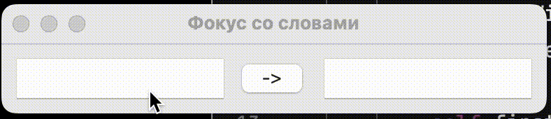

# Фокус со словами

| Характеристика | Значение |
| --- | --- |
| **Категория** | Классная работа |
| **Макс. балл** | 25 |
| **Ограничение времени** | 1 секунда |
| **Ограничение памяти** | 64Mb |
| **Ввод** | стандартный ввод или input.txt |
| **Вывод** | стандартный вывод или output.txt |
| **ID задачи** | `88822` |

---

## Условие

Напишите перекидыватель слов. На форме разместите два поля для ввода и кнопку. На кнопке должна быть показана стрелка от первого поля ко второму. В первое поле вводится строчка, по нажатию кнопки эта строчка перебрасывается в другое поле, при этом на кнопке меняется стрелка на противоположную. При повторном нажатии строчка летит обратно, а стрелка на кнопке меняется на изначальную. И так далее. При этом строчка должна перекидываться в направлении, которое указывает стрелка, и перекидываться должна даже пустая строка.

Класс, реализующий окно приложения, назовите **WordTrick**. Поле, находящееся слева от кнопки - **first\_value**, справа - **second\_value**. Оба поля должны быть типа **QLineEdit**. Кнопку назовите - **trick\_button**. Для изображения стрелки на кнопке используйте символы **"->"** и **"<-"**.
