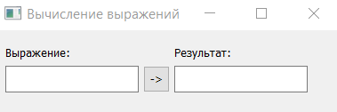

# Вычисление выражений

| Характеристика | Значение |
| --- | --- |
| **Категория** | Классная работа |
| **Макс. балл** | 25 |
| **Ограничение времени** | 1 секунда |
| **Ограничение памяти** | 64Mb |
| **Ввод** | стандартный ввод или input.txt |
| **Вывод** | стандартный вывод или output.txt |
| **ID задачи** | `88933` |

---

## Условие

Напишите программу с графическим пользовательским интерфейсом на PyQT. В однострочное поле вводится корректное арифметическое выражение, которое можно вычислить без ошибок. По кнопке надо посчитать результат этого выражения и вывести его в другое поле для ввода. Чтобы вычислить любое выражение, заданное в строке, можно использовать функцию **eval()**.

**Пример:** 1 + 2 \* 3 -> 7

Класс, реализующий окно приложения, назовите **Evaluator**. Поле, находящееся слева от кнопки - **first\_value**, справа - **second\_value**. Оба поля должны быть типа **QLineEdit**. Кнопку назовите - **trick\_button**. Для изображения стрелки на кнопке используйте символы **"->"**.
