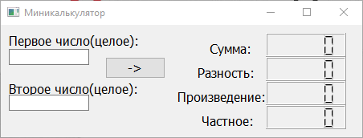

# Миникалькулятор

| Характеристика | Значение |
| --- | --- |
| **Категория** | Классная работа |
| **Макс. балл** | 25 |
| **Ограничение времени** | 1 секунда |
| **Ограничение памяти** | 64Mb |
| **Ввод** | стандартный ввод или input.txt |
| **Вывод** | стандартный вывод или output.txt |
| **ID задачи** | `88971` |

---

## Условие

Напишите программу с графическим пользовательским интерфейсом на PyQT, в которой в два текстовых поля вводятся целые числа. После нажатия на кнопку программа должна вычислить сумму, разность, частное и произведение введенных чисел и вывести результат каждой операции в отдельные виджеты **QLCDNumber**. В случае попытки деления на 0 программа должна выводить вместо частного строку **"Error"**.

Класс, реализующий окно приложения, назовите **MiniCalculator**. Поле для ввода первого числа назовите **number\_1**, второго - **number\_2**. Оба поля должны быть типа **QLineEdit**. Кнопку назовите - **calculate\_button**. Для изображения стрелки на кнопке используйте символы **"->"**. Поле для вывода результата суммы назовите **result\_sum**, разности - **result\_sub**, умножение - **result\_mul**, деления - **result\_div**. Все поля для вывода результатов должны быть типа **QLCDNumber**.

## Примечания

Для дробных чисел выводите три знака после запятой.
