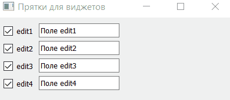

# Прятки для виджетов

| Характеристика | Значение |
| --- | --- |
| **Категория** | Классная работа |
| **Макс. балл** | 25 |
| **Ограничение времени** | 1 секунда |
| **Ограничение памяти** | 64Mb |
| **Ввод** | стандартный ввод или input.txt |
| **Вывод** | стандартный вывод или output.txt |
| **ID задачи** | `89072` |

---

## Условие

Посмотрите документацию на виджет **QCheckBox**, а затем научитесь «прятать» и «возвращать» виджеты. Если не удается найти, подумайте, как по-английски будет «прятать» и «показать». После этого разместите на форме четыре виджета типа **QLineEdit**, а рядом с ними чекбоксы (**QCheckBox**). Напишите обработчики, которые прячут и показывают виджеты в зависимости от состояния чекбокса. Попробуйте не писать по обработчику для каждого чекбокса, а сделать один универсальный.

Класс, реализующий окно приложения, назовите **WidgetsHideNSeek**. Виджеты, которые будут прятаться, назовите **edit1**, **edit2**, **edit3**, **edit4**, чекбоксы **checkbox1**, **checkbox2**, **checkbox3**, **checkbox4**.
