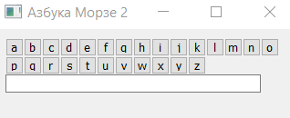

# Азбука Морзе 2

| Характеристика | Значение |
| --- | --- |
| **Категория** | Домашняя работа |
| **Макс. балл** | 25 |
| **Ограничение времени** | 1 секунда |
| **Ограничение памяти** | 64Mb |
| **Ввод** | стандартный ввод или input.txt |
| **Вывод** | стандартный вывод или output.txt |
| **ID задачи** | `89150` |

---

## Условие

Разместите на форме (**QWidget**) кнопки (**QPushButton**) с латинскими буквами, а так же поле для ввода (**QLineEdit**). При нажатии на кнопку с буквой добавляйте в поле код этой буквы из азбуки Морзе. Не создавайте каждую кнопку вручную, воспользуйтесь циклом.

Класс, реализующий окно приложения, назовите **MorseCode**. Поле для вывода результата **result**. Объекты кнопок для букв алфавита поместите в словарь, где ключом является строка, содержащая соответствующую букву в нижнем регистре. Словарь поместите свойством в объект окна, свойство назовите **alphabet\_buttons**.
