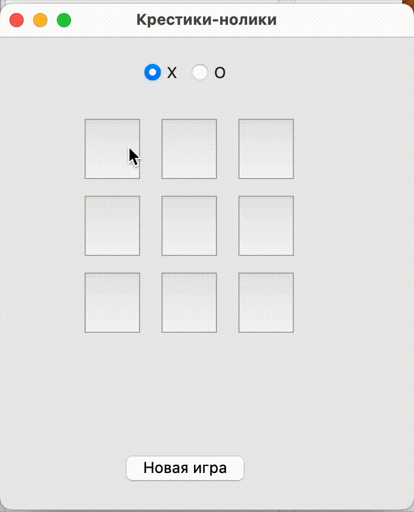

# Крестики нолики QT edition

| Характеристика | Значение |
| --- | --- |
| **Категория** | Домашняя работа |
| **Макс. балл** | 25 |
| **Ограничение времени** | 1 секунда |
| **Ограничение памяти** | 64Mb |
| **Ввод** | стандартный ввод или input.txt |
| **Вывод** | стандартный вывод или output.txt |
| **ID задачи** | `89203` |

---

## Условие

Разработайте игру «Крестики-нолики» на поле 3×3 с графическим пользовательским интерфейсом на PyQT.

Поле должно быть формой (**QWidget**) с набором кнопок (**QPushButton**) ( подсказка: виджеты можно объединять в списки).

При нажатии на кнопку в зависимости от того, чей ход, текст кнопки меняется на 'X' или 'O'. Выбор первого игрока производится с помощью **QRadioButton** (по умолчанию первых игрок **X**). В случае победы или ничьей должно отображаться соответствующее сообщение. Для отображения надо использовать виджет **QLabel**. В случае победы X отображать "Выиграл X!", в случае победы O отображать " Выиграл O!", в случае ничьей отображать "Ничья!". После победы одного из игроков игровое поле нужно блокировать до начала новой игры. Новая игра может быть начата после нажатия на соответствующую кнопку (**QPushButton**) или при смене обозначения хода у первого игрока (**QRadioButton**).

Класс, реализующий окно приложения, назовите **TicTacToe**. Кнопки для выполнения хода поместите построчно во вложенный список, а сам список в свойство в объект окна и назовите его **button\_grid**. Обработчики нажатия на кнопки поля подключите к каждой кнопке индивидуально.Поле **QLabel** для отображения результата назовите **result**. **QRadioButton** для выбора первого игрока назовите **x\_radio** и **o\_radio** соответственно. Кнопку для начала новой игры **new\_game\_button**.
