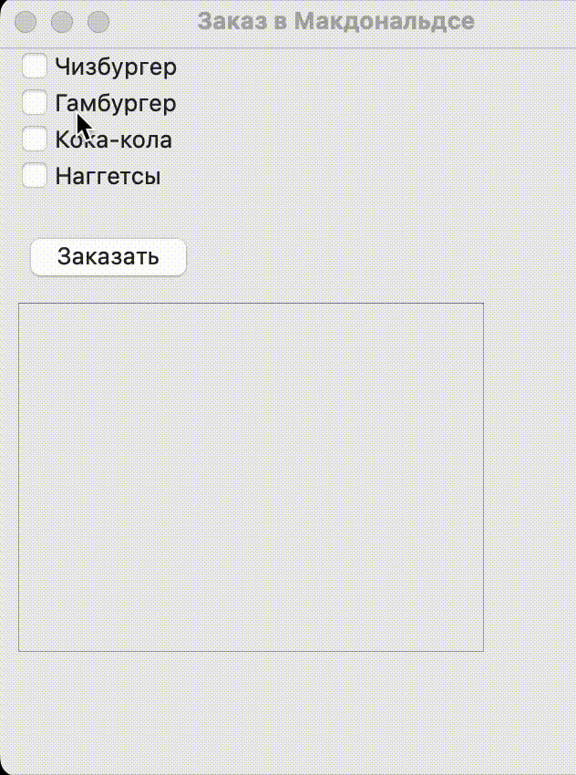

# Заказ в Макдональдсе

| Характеристика | Значение |
| --- | --- |
| **Категория** | Домашняя работа |
| **Макс. балл** | 25 |
| **Ограничение времени** | 1 секунда |
| **Ограничение памяти** | 64Mb |
| **Ввод** | стандартный ввод или input.txt |
| **Вывод** | стандартный вывод или output.txt |
| **ID задачи** | `89227` |

---

## Условие

Напишите программу «Заказ в Макдональдсе» с графическим пользовательским интерфейсом на PyQT.

Пользователь должен иметь возможность выбирать одно или несколько блюд. После нажатия на кнопку **«Заказать»** в отдельном виджете должен отображаться «чек» с выбранными позициями.

Класс, реализующий окно приложения назовите **MacOrder**. Для выбора позиций используйте виджет **QCheckBox**. Храните список из чекбоксов в атрибуте **menu\_checkboxes** объекта класса приложения.

Позиции в меню: "Чизбургер", "Гамбургер", "Кока-кола", "Наггетсы".

Кнопка заказа должна называться **order\_btn**.

Заказ должен выводится в виджет **QPlainTextEdit** с названием **result**. Позиции в заказе должны выводится в том же порядке, как в меню. Текст заказа должен начинаться с **«Ваш заказ:»** и пустой строки.

