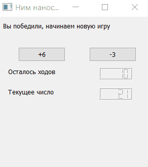

# Ним наносит ответный удар

| Характеристика | Значение |
| --- | --- |
| **Категория** | Дополнительные задачи |
| **Макс. балл** | 33 |
| **Ограничение времени** | 1 секунда |
| **Ограничение памяти** | 64Mb |
| **Ввод** | стандартный ввод или input.txt |
| **Вывод** | стандартный вывод или output.txt |
| **ID задачи** | `89278` |

---

## Условие

Давайте попробуем создать небольшую игру с графическим пользовательским интерфейсом на PyQT, которая по своей сути напоминает некоторую вариацию игр Ним, которые мы делали раньше.

В начале игры генерируется число X и выводится на экран. Также создаются две кнопки, одна из которых отвечает за увеличение этого числа на Y, а вторая — за уменьшение числа на Z. X, Y, Z — случайные положительные целые числа.

Задача игрока — с помощью этих двух кнопок за 10 ходов привести значение Х к 0. Количество оставшихся ходов должно выводиться на экран. Если у пользователя получилось выиграть, нужно вывести поздравительное сообщение, если нет — вывести сообщение о проигрыше и начать игру заново с новыми значениями X, Y, Z.

Класс, реализующий окно приложения, назовите **NimStrikesBack**. Сообщения о проигрыше и выигрыше поместите в **QLabel** **result\_label**. Также в классе должны быть поля **X**, **Y**, **Z**, с соответствующей информацией. Кнопку для увеличения на Y назовите **btnp**, для уменьшения на Z назовите **btnm**.
