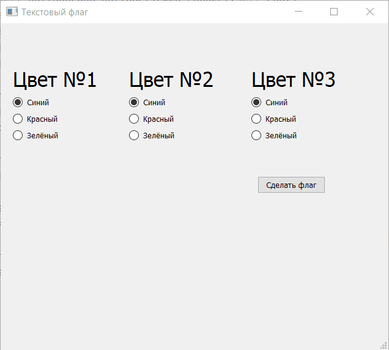

# Текстовый флаг

| Характеристика | Значение |
| --- | --- |
| **Категория** | Классная работа |
| **Макс. балл** | 33 |
| **Ограничение времени** | 1 секунда |
| **Ограничение памяти** | 64Mb |
| **Ввод** | стандартный ввод или input.txt |
| **Вывод** | стандартный вывод или output.txt |
| **ID задачи** | `88944` |

---

## Условие

Напишите приложение «Текстовый флаг» с графическим пользовательским интерфейсом на PyQT.

Пользователь должен иметь возможность выбрать цвет для каждой из трёх полос флага с помощью Radio Button из трех вариантов. После выбора и нажатия на кнопку «Сделать флаг» программа должна выводить сообщение, соответствующее выбранным цветам. Например: «Красный, Зелёный, Белый».

Класс, реализующий окно приложения, назовите **FlagMaker**.

Группы кнопок для выбора цветов должны быть типа **QButtonGroup**.

Кнопки каждого цвета должны быть типа **QRadioButton**. Кнопки выбора цветов должны быть добавлены в группы кнопок в порядке, изображенном на анимации (Синий, Красный, Зелёный).

Кнопка для генерации флага должна называться **make\_flag**. Элемент итогового текстового флага должен иметь тип **QLabel** и называться **result**.

Группы кнопок для выбора первого, второго, третьего цвета назовите **color\_group\_1**, **color\_group\_2**, **color\_group\_3** соответственно. Кнопки надо добавлять в группы в следующем порядке цветов: "Синий", "Красный", "Зелёный". Создание виджетов **QButtonGroup** и добавление в них кнопок лучше делать не с использованием **QtDesigner**, а в коде своей программы.

Сделайте так, чтобы размер окна нельзя было изменять. Выберите размер на свое усмотрение. Как это сделать можно посмотреть в [документации](https://doc.qt.io/qtforpython-5/PySide2/QtWidgets/QWidget.html#PySide2.QtWidgets.PySide2.QtWidgets.QWidget.setFixedSize)

