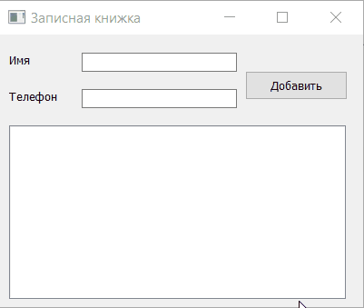

# Записная книжка

| Характеристика | Значение |
| --- | --- |
| **Категория** | Домашняя работа |
| **Макс. балл** | 33 |
| **Ограничение времени** | 1 секунда |
| **Ограничение памяти** | 64Mb |
| **Ввод** | стандартный ввод или input.txt |
| **Вывод** | стандартный вывод или output.txt |
| **ID задачи** | `89078` |

---

## Условие

Напишите программу «Записная книжка» с графическим пользовательским интерфейсом на PyQT, используя необходимые виджеты.

Класс, реализующий это приложение назовите **MyNotes**.

Виджеты ввода имени и телефона должны являться **QLineEdit** и называться **contactName** и **contactNumber** соответственно.

Кнопку добавления контакта назовите **addContactBtn**.

Список контактов реализуйте через **QListWidget** и назовите **contactList**.

Пользователь должен иметь возможность ввести имя контакта и его номер. После добавление данные должны отображаться в списке.
