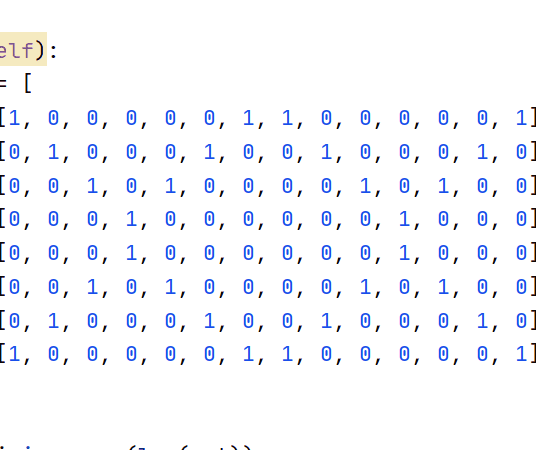

# Widget Art

| Характеристика | Значение |
| --- | --- |
| **Категория** | Домашняя работа |
| **Макс. балл** | 33 |
| **Ограничение времени** | 1 секунда |
| **Ограничение памяти** | 64Mb |
| **Ввод** | стандартный ввод или input.txt |
| **Вывод** | стандартный вывод или output.txt |
| **ID задачи** | `89111` |

---

## Условие

Напишите программу Widget Art. Эта программа должна визуализировать матрицу, в которой могут быть записаны нули или единицы, с помощью виджетов PyQT. Матрица передается в качестве аргумента при инициализации класса **WidgetArt** приложения.

Для отображения изпользуйте таблицу из кнопок. **1** в матрице соответствует **\*** в кнопке, **0** соответствует пустой строке.

Для отображении таблицы используйте **QGridLayout**. Этот элемент должен называться **widgetArt**.

Пример того как матрица передается программе:

```
        matrix = [

            [1, 0, 0, 0, 0, 0, 1, 1, 0, 0, 0, 0, 0, 1],  

            [0, 1, 0, 0, 0, 1, 0, 0, 1, 0, 0, 0, 1, 0],  

            [0, 0, 1, 0, 1, 0, 0, 0, 0, 1, 0, 1, 0, 0],  

            [0, 0, 0, 1, 0, 0, 0, 0, 0, 0, 1, 0, 0, 0],  

            [0, 0, 0, 1, 0, 0, 0, 0, 0, 0, 1, 0, 0, 0],  

            [0, 0, 1, 0, 1, 0, 0, 0, 0, 1, 0, 1, 0, 0],  

            [0, 1, 0, 0, 0, 1, 0, 0, 1, 0, 0, 0, 1, 0],  

            [1, 0, 0, 0, 0, 0, 1, 1, 0, 0, 0, 0, 0, 1],  

        ]  

        ex = WidgetArt(matrix)
```


