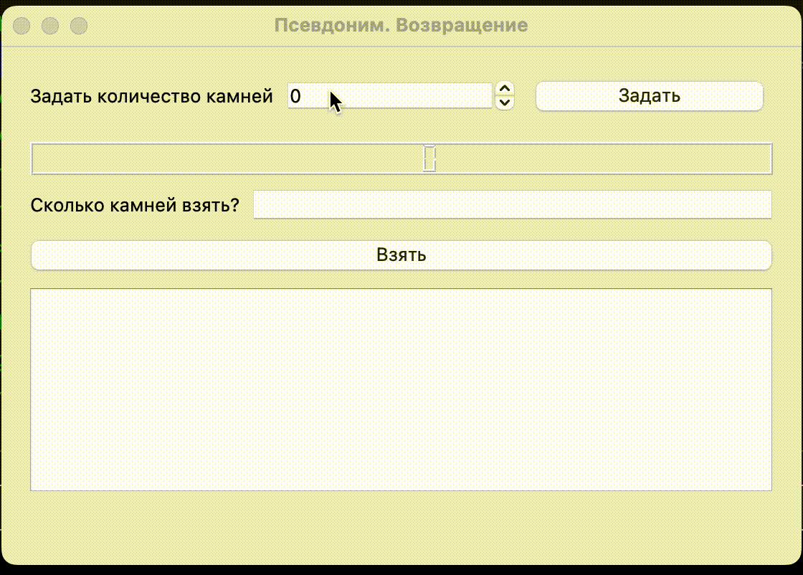

# Псевдоним. Возвращение

| Характеристика | Значение |
| --- | --- |
| **Категория** | Домашняя работа |
| **Макс. балл** | 34 |
| **Ограничение времени** | 1 секунда |
| **Ограничение памяти** | 64Mb |
| **Ввод** | стандартный ввод или input.txt |
| **Вывод** | стандартный вывод или output.txt |
| **ID задачи** | `89145` |

---

## Условие

Добавьте к программе «Псевдоним» графический пользовательский интерфейс на PyQT.

Напоминаем правила. Игра заключается в следующем: в одной куче лежит N камней, каждому из двух игроков разрешается по очереди брать не более 3 камней. Выигрывает тот, кто возьмёт последний. Количество камней должно задаваться перед началом новой игры.

Класс, реализующий окно приложения назовите **Pseudonym**.

Оставшееся количество камней на столе должно отображаться на экране в виджете **QLCDNumber**, который называется **remainLcd**. Для ввода количества камней в игре используйте **QSpinBox**, назовите этот виджет **stones**, кнопку для начала новой игры **startButton**. Поле ввода количества камней которое хочет взять пользователь назовите **takeInput**, кнопку для взятия камней из кучи **takeButton**. Отображение истории игры реализуйте с помощью **QListWidget**, назовите этот виджет **listWidget**.

В случае победы игрока выводите "Победа пользователя!" в виджет с названием **resultLabel**. При победе компьютера выводите "Победа компьютера!".

Ходы вашего ИИ не должны противоречить правилам игры.
