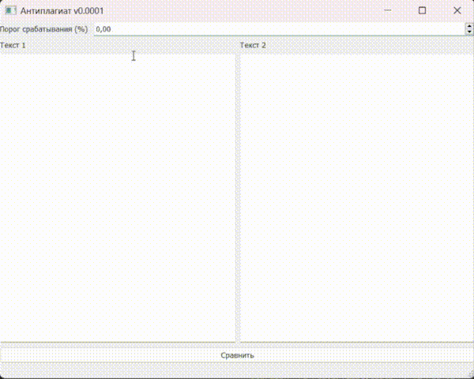

# Антиплагиат v0.0001

| Характеристика | Значение |
| --- | --- |
| **Категория** | Дополнительные задачи |
| **Макс. балл** | 100 |
| **Ограничение времени** | 1 секунда |
| **Ограничение памяти** | 64Mb |
| **Ввод** | стандартный ввод или input.txt |
| **Вывод** | стандартный вывод или output.txt |
| **ID задачи** | `89172` |

---

## Условие

Напишите программу с графическим интерфейсом на PyQT с использованием Layout, которая реализует простейшую проверку на антиплагиат. На форме приложения должно содержаться:

Виджет **QDoubleSpinBox** для задания порога срабатывания антиплагиата, назовите его **alert\_value**. Два **QPlainTextEdit** для ввода текста. Назовите их **text1** и **text2**. Кнопка для расчета результата, которая должна называться **checkBtn**. Для вывода результата сравнения используйте виджет **QStatusBar**, который уже есть в классе **QMainWindow**, он называется **statusbar**. Для получения доступа к этому виджету используйте метод **statusBar** класса **QMainWindow**. Класс, реализующий окно приложения назовите **AntiPlagiarism**, унаследуйте его от класса **QMainWindow**.

В качестве значения похожести текстов используйте отношения количества уникальных строк, встречающихся в обоих текстах, к общему количеству уникальных строк (в процентах, с точностью до 2 знаков после запятой).

Примеры сообщений, которые должны выводится в результате проверки на плагиат:

"Тексты похожи на 50.01%, плагиат"  
"Тексты похожи на 1.01%, не плагиат"
