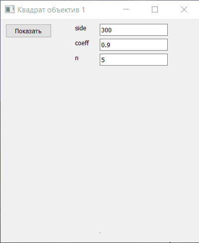

# Квадрат-объектив — 1

| Характеристика | Значение |
| --- | --- |
| **Категория** | Классная работа |
| **Макс. балл** | 33 |
| **Ограничение времени** | 10 секунд |
| **Ограничение памяти** | 64Mb |
| **Ввод** | стандартный ввод или input.txt |
| **Вывод** | стандартный вывод или output.txt |
| **ID задачи** | `88951` |

---

## Условие

Напишите программу «Квадрат-объектив — 1» с графическим пользовательским интерфейсом. На экране нарисован квадрат. Пользователем в соответствующие поля вводятся три параметра:

Целое число **a** — размер стороны самого большого квадрата в пикселях (по умолчанию равен 300)  
Вещественное число **k** — коэффициент масштабирования (<1, по умолчанию равен 0.9)  
Целое число **n** — количество повторений (по умолчанию равно 10) Программа строит n квадратов, сторона каждого следующего квадрата определяется по формуле: **ai = ai-1\*k**.  
Все квадраты имеют общий центр.

Класс, реализующий окно приложения, назовите **Square1**. Размер окна приложения сделайте строго 800 на 900 пикселей. Кнопку, которая будет рисовать квадраты, назовите **btn**. Поле ввода размера стороны квадрата **lineEdit**. Поля для ввода коэффициента и количества квадратов назовите **lineEdit\_2** и **lineEdit\_3** соответственно.

Цвет, которым вы будете рисовать квадраты должен отличаться от фонового и должен быть сохранён в атрибут **color** объекта класса приложения в виде **QColor**. Для изображения квадрата воспользуйтесь методом [**drawRect**](https://doc.qt.io/qtforpython-6/PySide6/QtGui/QPainter.html#PySide6.QtGui.QPainter.drawRect) класса [**QPainter**](https://doc.qt.io/qtforpython-6/PySide6/QtGui/QPainter.html#PySide6.QtGui.QPainter). Для создания объекта прямоугольника, который передается методу **drawRect**, используйте класс [**QRectF**](https://doc.qt.io/qtforpython-6/PySide6/QtCore/QRectF.html#PySide6.QtCore.QRectF). Все вычисления производите в вещественных числах, вещественные результаты вычислений передавайте конструктору класса **QRectF** Левая верхняя точка самого большого квадрата должна иметь координаты (50, 130). Все элементы управления (поля для ввода данных и кнопки) расположите выше этих координат.
