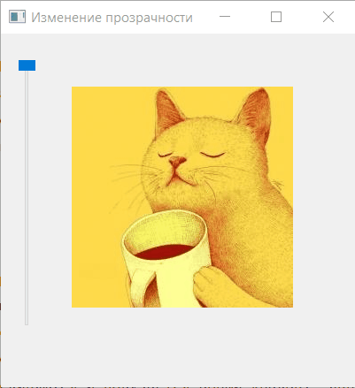

# Управление прозрачностью

| Характеристика | Значение |
| --- | --- |
| **Категория** | Классная работа |
| **Макс. балл** | 34 |
| **Ограничение времени** | 10 секунд |
| **Ограничение памяти** | 64Mb |
| **Ввод** | стандартный ввод или input.txt |
| **Вывод** | стандартный вывод или output.txt |
| **ID задачи** | `88973` |

---

## Условие

Изучите самостоятельно виджет QSlider.

Напишите программу с графическим пользовательским интерфейсом, которая открывает изображение, находящееся в файле **orig.jpg**, и с помощью слайдера регулирует его прозрачность (alpha-канал).

Оригинальное изображение, которое нужно будет изменять, лежит в файле **orig.jpg**. После каждого изменения прозрачности, новое изображение нужно сохранять в файл **new.png**

Класс, реализующий окно приложения, назовите **AlphaManagement**. слайдер должен называться **alpha**, а изображение в формате QPixmap должно называться **pixmap**

Значение прозрачности изменяется от 255 (не прозрачное) до 0 (полностью прозрачное).
