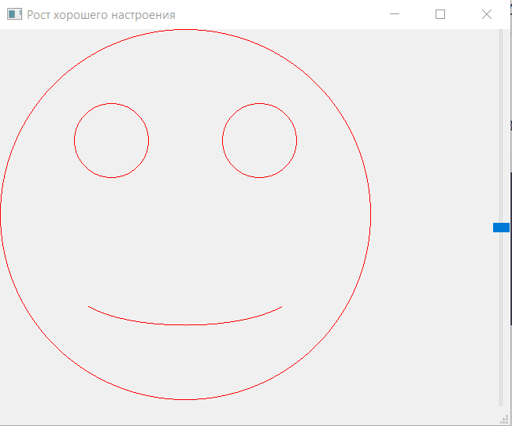

# Рост хорошего настроения

| Характеристика | Значение |
| --- | --- |
| **Категория** | Домашняя работа |
| **Макс. балл** | 33 |
| **Ограничение времени** | 10 секунд |
| **Ограничение памяти** | 64Mb |
| **Ввод** | стандартный ввод или input.txt |
| **Вывод** | стандартный вывод или output.txt |
| **ID задачи** | `89079` |

---

## Условие

Напишите программу с графическим пользовательским интерфейсом на PyQT. При запуске программы средствами QPainter должен рисоваться смайлик. С помощью слайдера можно управлять масштабом смайлика.

Класс, реализующий окно приложения, назовите **GoodMoodRising**.

На слайдере установите 0 минимальным значением, а 100 максимальным. Изначальное 50. Слайдер назовите **slider**. Также, он обязательно должен быть вертикальным, выходить из точки (970, 40) (левый верхний угол), быть шириной в 20 пикселей и высотой в 500

пусть size - значение на слайдере. Тогда, большой круг должен быть вписан в квадрат, начинающийся из (0, 0) и стороной 10 \* size. Левый глаз должен быть вписан в квадрат из точки (2 \* size, 2 \* size) и иметь радиус 2 \* size. Правый глаз должен быть симметричен

Улыбку нарисуйте из точки (2 \* size, 6 \* size). Она должна иметь длинну 6 \* size, высоту 2 \* size. Для улыбки используйте функцию **drawArc**. Оставшиеся 2 параметра (a, alen) должны равняться (-480, -1920)

Цвет, которым будете рисовать, сохраните в классе, назвав **color** (тип данных **QColor**). Размер окна приложения сделайте строго 1000 по каждому измерению.
