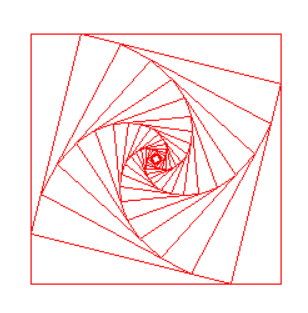
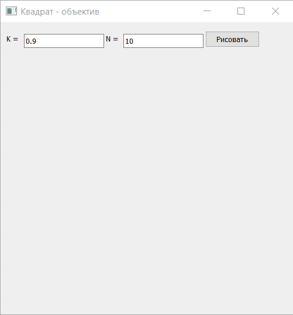

# Квадрат-объектив — 2

| Характеристика | Значение |
| --- | --- |
| **Категория** | Домашняя работа |
| **Макс. балл** | 34 |
| **Ограничение времени** | 10 секунд |
| **Ограничение памяти** | 64Mb |
| **Ввод** | стандартный ввод или input.txt |
| **Вывод** | стандартный вывод или output.txt |
| **ID задачи** | `89133` |

---

## Условие

Напишите программу «Квадрат-объектив — 2». На экране нарисован квадрат. Пользователь в соответствующие поля вводит вещественное число k (< 1) — коэффициент масштабирования стороны и целое число n — количество повторений.

Каждая сторона квадрата делится в пропорции, соответствующей указанному коэффициенту, полученные точки соединяются и получается новый квадрат. Данная операция повторяется n раз. Например, если задать k = 0.8, а n = 20, результат должен получиться такой:

Самый большой квадрат должен идти из точки с координатами (150, 150) и иметь сторону 200

Класс, реализующий окно приложения, назовите **Square2**.

Поле для ввода числа k назовите **k**. Для числа n соответственно **n**

Цвет, которым вы будете рисовать квадраты сохраните в атрибуте **color** объекта класса приложения при инициализации в виде **QColor**.

Кнопку назовите **draw**

  
Размер окна приложения сделайте строго 500 пикселей по каждому измерению. Для изображения квадрата воспользуйтесь методом [**drawPolygon**](https://doc.qt.io/qtforpython-6/PySide6/QtGui/QPainter.html#PySide6.QtGui.QPainter.drawPolygon) класса [**QPainter**](https://doc.qt.io/qtforpython-6/PySide6/QtGui/QPainter.html#PySide6.QtGui.QPainter). Для создания объекта многоугольника, который передается методу **drawPolygon**, используйте класс [**QPolygonF**](https://doc.qt.io/qtforpython-6/PySide6/QtGui/QPolygonF.html#PySide6.QtGui.QPolygonF). Для добавления точек в многоугольник используйте метод [**append**](https://doc.qt.io/qtforpython-6/PySide6/QtGui/QPolygonF.html#PySide6.QtGui.QPolygonF.append). Все вычисления производите в вещественных числах, вещественные результаты вычислений передавайте конструктору класса [**QPointF**](https://doc.qt.io/qtforpython-6/PySide6/QtCore/QPointF.html#PySide6.QtCore.QPointF) - это точки - вершины многоугольника.
