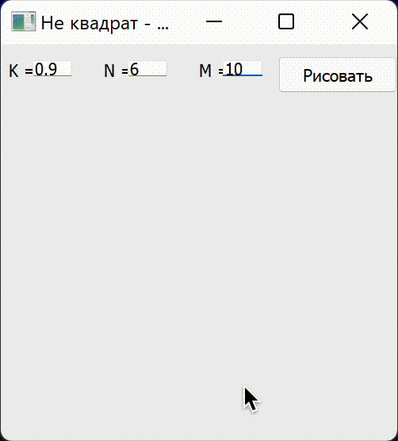

# Не квадрат-объектив

| Характеристика | Значение |
| --- | --- |
| **Категория** | Дополнительные задачи |
| **Макс. балл** | 50 |
| **Ограничение времени** | 10 секунд |
| **Ограничение памяти** | 64Mb |
| **Ввод** | стандартный ввод или input.txt |
| **Вывод** | стандартный вывод или output.txt |
| **ID задачи** | `89201` |

---

## Условие

Модифицируйте программу «Квадрат-объектив — 2». Теперь должен строиться не квадрат, а правильный N-угольник, а цвет для его построения должен получаться с помощью диалога выбора цвета.

Класс, реализующий окно приложения, назовите **NoTSquare**.

Поле для ввода числа k назовите **k**. Для чисел n и m, соответственно **n** и **m**

Кнопку назовите **draw**

Для диалога выбора цвета используйте класс **QColorDialog**. Создайте экземпляр из этого класса QColorDialog(), а затем вызовите у него нужный метод.

n-угольник должен быть вписан в окружность с центром в точке (250, 250) и радиусом 100

Одна из вершин вашего n-угольника должна быть сохранена при инициализации приложения в атрибуте **start\_point** объекта класса приложения в виде списка, содержащем x и y координаты этой точки.  
Размер окна приложения сделайте строго 500 пикселей по каждому измерению. Для изображения многоугольника воспользуйтесь методом [**drawPolygon**](https://doc.qt.io/qtforpython-6/PySide6/QtGui/QPainter.html#PySide6.QtGui.QPainter.drawPolygon) класса [**QPainter**](https://doc.qt.io/qtforpython-6/PySide6/QtGui/QPainter.html#PySide6.QtGui.QPainter). Для создания объекта многоугольника, который передается методу **drawPolygon**, используйте класс [**QPolygonF**](https://doc.qt.io/qtforpython-6/PySide6/QtGui/QPolygonF.html#PySide6.QtGui.QPolygonF). Для добавления точек в многоугольник используйте метод [**append**](https://doc.qt.io/qtforpython-6/PySide6/QtGui/QPolygonF.html#PySide6.QtGui.QPolygonF.append). Все вычисления производите в вещественных числах, вещественные результаты вычислений передавайте конструктору класса [**QPointF**](https://doc.qt.io/qtforpython-6/PySide6/QtCore/QPointF.html#PySide6.QtCore.QPointF) - это точки - вершины многоугольника.
