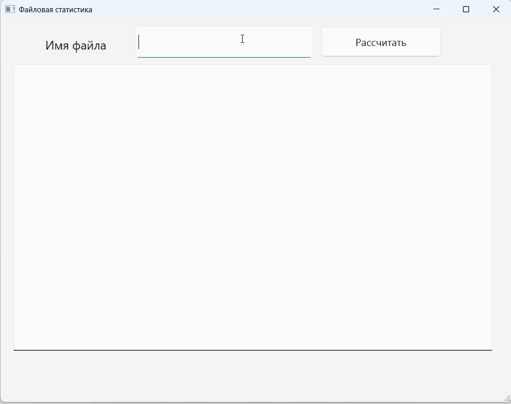

# Файловая статистика

| Характеристика | Значение |
| --- | --- |
| **Категория** | Классная работа |
| **Макс. балл** | 25 |
| **Ограничение времени** | 1 секунда |
| **Ограничение памяти** | 64 Мб |
| **Ввод** | стандартный ввод или in.txt |
| **Вывод** | стандартный вывод или out.txt |
| **ID задачи** | `88923` |

---

## Условие

Напишите приложение с графическим пользовательским интерфейсом на PyQT, которое позволяет пользователю задать имя текстового файла, в котором содержатся через пробельные символы (пробел, табуляция, перевод строки и т. д.) целые числа. По нажатию на кнопку необходимо вывести в соответствующие виджеты максимальное, минимальное и среднее значение из этого файла. Эту же информацию необходимо сохранить в файл `out.txt`.

По нажатию на кнопку необходимо в поле `QTextBrowser` вывести максимальное, минимальное и среднее значение из этого файла в формате:

```
Максимальное значение = [целое число]
Минимальное значение = [целое число]
Среднее значение = [число с двумя знаками после запятой (при выводе использовать форматированный вывод)]
```

Для этого класс должен реализовывать метод `min_med_max`, который считает и выводит эти значения в статус-бар.

Рассмотрим крайние случаи:

* В случае, если файл не существует, следует выводить текст «Указанный файл не существует» в статусбар. Этот виджет QStatusBar уже есть в классе QMainWindow, он называется statusBar. Для получения доступа к этому виджету испольльзуйте метод statusBar класса QMainWindow.
* Если файл пуст или состоит только из пробельных символов (пробелов, символов табуляции и переноса строки и т. д.), в статусбаре отображать сообщение «Указанный файл пуст».
* Пользователь приложения может случайно указать файл с некорректным содержимым: вещественными числами или текстовыми данными. Если программа не может корректно считать целые числа из файла, в статусбаре необходимо отобразить «Файл содержит некорректные данные».

Во всех трех случаях следует обнулить поле вывода.

Класс, реализующий окно приложения и наследующийся от `QMainWindow`, назовите `FileStat`. Поле ввода названия файла — `filenameEdit`, кнопку — `button`. Поле для вывода назовите `textBrowser`.


