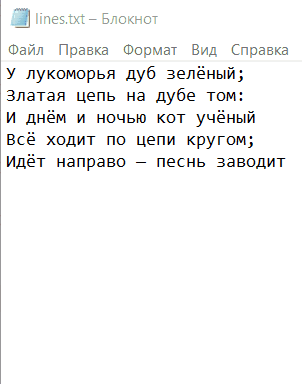

# Перемешивание

| Характеристика | Значение |
| --- | --- |
| **Категория** | Домашняя работа |
| **Макс. балл** | 33 |
| **Ограничение времени** | 1 секунда |
| **Ограничение памяти** | 64 Мб |
| **Ввод** | стандартный ввод или input.txt |
| **Вывод** | стандартный вывод или output.txt |
| **ID задачи** | `89093` |

---

## Условие

В папке с вашей программой лежит текстовый файл `lines.txt`. Ваша задача — написать приложение на PyQT6 для вывода строк из этого файла в поле `QTextBrowser` по нажатию на кнопку: сначала выводятся все чётные строки, а потом — все нечётные. Первая строка считается нечётной.

Класс, реализующий окно приложения, назовите `Shuffle` и унаследуйте от `QWidget`, кнопку назовите `button`, текстовое поле — `text_field`, а так же метод открытия файла `load_strings`.
