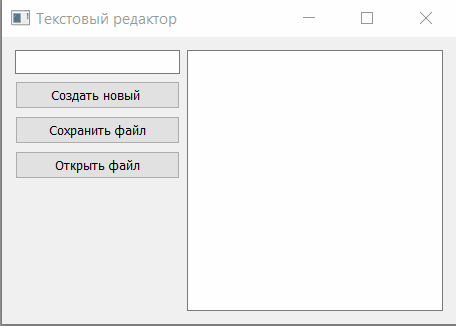

# Текстовый редактор 1.0

| Характеристика | Значение |
| --- | --- |
| **Категория** | Домашняя работа |
| **Макс. балл** | 33 |
| **Ограничение времени** | 1 секунда |
| **Ограничение памяти** | 64 Мб |
| **Ввод** | стандартный ввод или input.txt |
| **Вывод** | стандартный вывод или output.txt |
| **ID задачи** | `89158` |

---

## Условие

Реализуйте на PyQT простой тестовый редактор, обладающий следующими функциями: открыть файл, создать новый файл, сохранить измененный файл.

* Кнопка **Создать новый** очищает виджеты, отображающие название файла и его содержимое.
* Кнопка **Сохранить файл** создает файл с указанным названием и записывает в него содержимое текстового поля. В случае, если такой файл уже существует, его содержимое перезаписывается на новое. Если название файла не указано, создавать файл не нужно.
* Кнопка **Открыть файл** проверяет, что указанный файл существует, и выводит его содержимое в текстовое поле, в противном случае ничего не происходит.

Класс `Notebook` должен определять методы `new_file`, `save_file`, `open_file`.

Класс, реализующий окно приложения, назовите `Notebook` и унаследуйте его от `QWidget`.  
 Кнопки назовите `new_button`, `save_button` и `open_button`.  
 Поле ввода названия файла назовите `filename_edit`, при этом используйте `QLineEdit`.  
 Поле ввода текста назовите `text_edit`, при этом используйте `QPlainTextEdit`.
