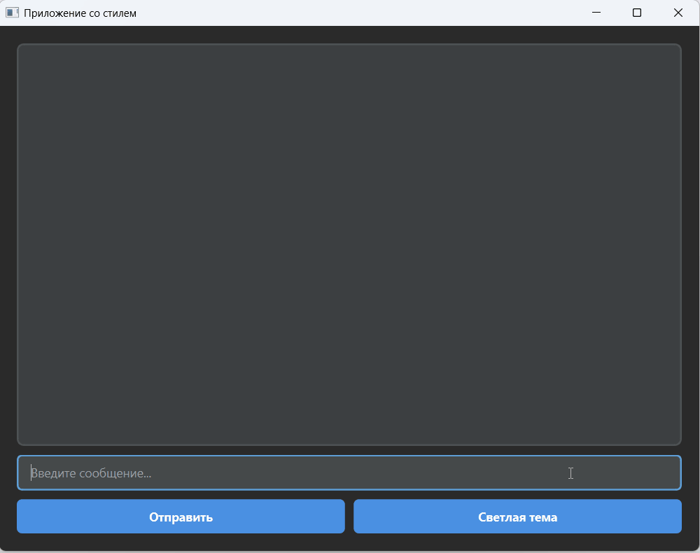

# Светлая тема/Тёмная тема

| Характеристика | Значение |
| --- | --- |
| **Категория** | Дополнительные задачи |
| **Макс. балл** | 50 |
| **Ограничение времени** | 1 секунда |
| **Ограничение памяти** | 64 Мб |
| **Ввод** | стандартный ввод или input.txt |
| **Вывод** | стандартный вывод или output.txt |
| **ID задачи** | `89230` |

---

## Условие

Напишите приложение на PyQT6, содержащее текстовый браузер (`textBrowser`), поле для ввода текста (`lineEdit`) и две кнопки (`pushButton` и `pushButton1`), оформление которого можно изменять по нажатию на вторую кнопку.

При загрузке окна тема тёмная, на второй кнопке написано **Светлая тема**. Если на неё нажать, то тема становится светлой, а надпись меняется на **Тёмная тема**.

Первая кнопка служит для отправки сообщений, написанных в поле ввода, в окно текстового браузера. Каждое сообщение предваряется текстом `Message: <введённый текст>` (Сообщение также можно отправить, нажав клавишу Enter на клавиатуре).

Класс, реализующий окно приложения, называется `MainWindow` и наследуется от `QMainWindow`, а так же должен содержать методы `send_message` и `change_theme`.

Задайте две глобальных константы со стилями для оформления тем:

* Тёмная тема: `dark_style`
* Светлая тема: `light_style`

Оформление светлой и тёмной темы вы можете выбрать самостоятельно, важно, чтобы оно находилось в глобальных константах, описанных выше.

## Примечания

Задача дополнительно проверяется преподавателем.
