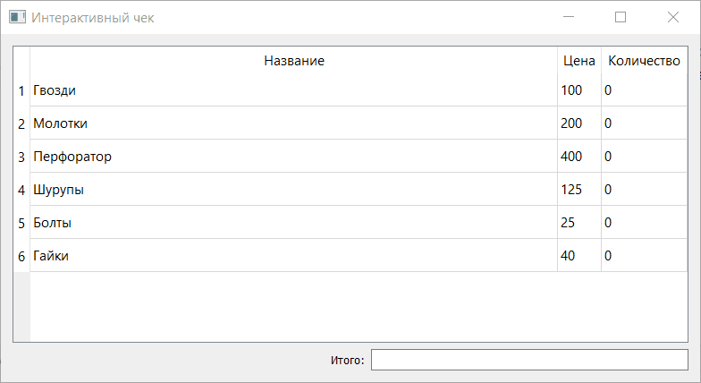

# Интерактивный чек

| Характеристика | Значение |
| --- | --- |
| **Категория** | Классная работа |
| **Макс. балл** | 25 |
| **Ограничение времени** | 10 секунд |
| **Ограничение памяти** | 64 Мб |
| **Ввод** | стандартный ввод или input.txt |
| **Вывод** | стандартный вывод или output.txt |
| **ID задачи** | `88911` |

---

## Условие

В файле [price.csv](./price.csv) содержатся цены на товары некоторого магазина через разделитель — точку с запятой.

Напишите приложение на PyQT6, наследующееся от `QWidget`, отображающее содержимое этого файла в виде таблицы в виджете `QTableWidget` с именем *tableWidget*. Добавьте колонку *«Количество»* с редактируемыми пользователем значениями, заполните ячейки нулями.

Также добавьте вывод итоговой суммы покупок в отдельном виджете `QLineEdit` с названием *total*. Отображаемое значение в виджете должно рассчитываться как сумма цен товаров, умноженных на их количество. При изменении количества любого из товаров должна пересчитываться итоговая сумма.

Класс, реализующий окно приложения, назовите *InteractiveReceipt*.
