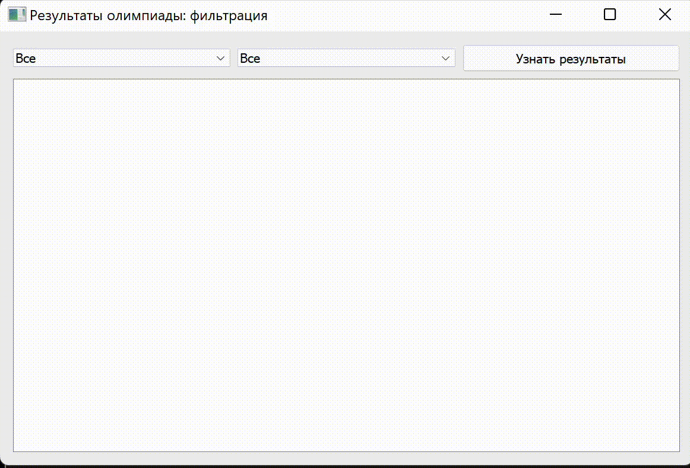

# Результаты олимпиады: призёры

| Характеристика | Значение |
| --- | --- |
| **Категория** | Дополнительные задачи |
| **Макс. балл** | 33 |
| **Ограничение времени** | 10 секунд |
| **Ограничение памяти** | 64 Мб |
| **Ввод** | стандартный ввод или input.txt |
| **Вывод** | стандартный вывод или output.txt |
| **ID задачи** | `89219` |

---

## Условие

Модифицируйте задачу *«Результаты олимпиады: фильтрация»* таким образом, чтобы после применения фильтрации выделялись цветами участники, которые заняли при выбранном фильтре 1, 2 и 3 место.

Если несколько участников набрали одинаковое количество баллов, то считается, что они заняли одно и то же место, таким образом может быть несколько первых мест, несколько вторых и несколько третьих. Выводить необходимо только логин, ФИО и суммарный балл.

Класс, реализующий окно приложения, наследуется от `QWidget` и называется *OlympResultWin*. Виджет `QTableWidget`, содержащий таблицу, назовите *tableWidget*.

Выпадающие списки нужно реализовать с помощью `QComboBox` и назвать\_ classes\_ и *schools* для соответствующего выбора.

Кнопку для фильтрации назовите *resultButton*. Цвет для первого места #CCCC00, второго #B5B5BD, третьего #9C5221.

Файл с данными **rez.csv** можно скачать по [ссылке](./rez.csv).
