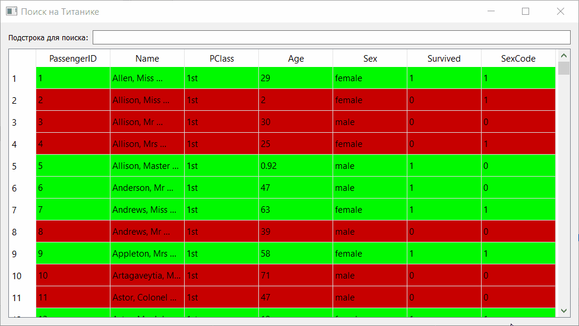

# Поиск на Титанике

| Характеристика | Значение |
| --- | --- |
| **Категория** | Дополнительные задачи |
| **Макс. балл** | 33 |
| **Ограничение времени** | 10 секунд |
| **Ограничение памяти** | 64 Мб |
| **Ввод** | стандартный ввод или input.txt |
| **Вывод** | стандартный вывод или output.txt |
| **ID задачи** | `89254` |

---

## Условие

Напишите программу с графическим пользовательским интерфейсом на PyQT, которая отображает информацию о пассажирах Титаника из [csv-файла](./titanic.csv) (этот файл часто используют, когда показывают простые примеры алгоритмов машинного обучения, так что вы, вероятно, его увидите ещё не раз), раскрашивая строки, содержащие информацию о выживших, одним цветом, а о погибших — другим.

Добавьте строку поиска по имени пассажира, которая должна работать следующим образом:

* Если в строке поиска менее трёх символов, поиск не производится и отображается информация обо всех пассажирах.
* Если в строке поиска три и более символов, отображаются данные только тех пассажиров, имя которых содержит введенную подстроку (вне зависимости от регистра).

Класс, реализующий окно приложения, назовите *TitanicSearch*.  
Виджет `QTableWidget`, содержащий таблицу, назовите *resultTable*.  
Строку поиска `QLineEdit` назовите *searchEdit*.  
Цвет для погибших #FF0000, для выживших #00FF00.
