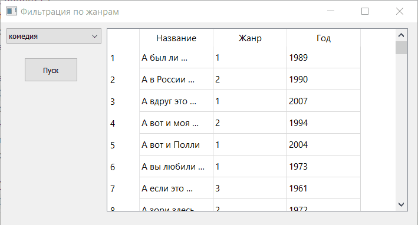

# Фильтрация по жанрам

| Характеристика | Значение |
| --- | --- |
| **Категория** | Классная работа |
| **Макс. балл** | 14 |
| **Ограничение времени** | 10 секунд |
| **Ограничение памяти** | 64Mb |
| **Ввод** | стандартный ввод или input.txt |
| **Вывод** | стандартный вывод или output.txt |
| **ID задачи** | `89160` |

---

## Условие

Напишите программу с графическим пользовательским интерфейсом на PyQT, которая позволяет просматривать информацию о названиях фильмов из базы данных [films\_db.sqlite](./films_db.sqlite) с возможностью фильтрации по жанрам.

Выбор жанров для фильтра должен отображаться в виде выпадающего списка, данные в который загружаются из базы данных из таблицы genres. В зависимости от выбранного пользователем названия жанра должны соответствующим образом фильтроваться названия отображаемых фильмов.

 Назовите главный класс программы **MyWidget**.

Назовите виджет для выбора жанра, по которому будет производиться поиск -- **parameterSelection**.

Таблицу для вывода информации о фильмах назовите **tableWidget**. В ней должны быть столбцы с **названием**, **жанром**, **годом выпуска**.

У кнопки должно быть название **queryButton**.
