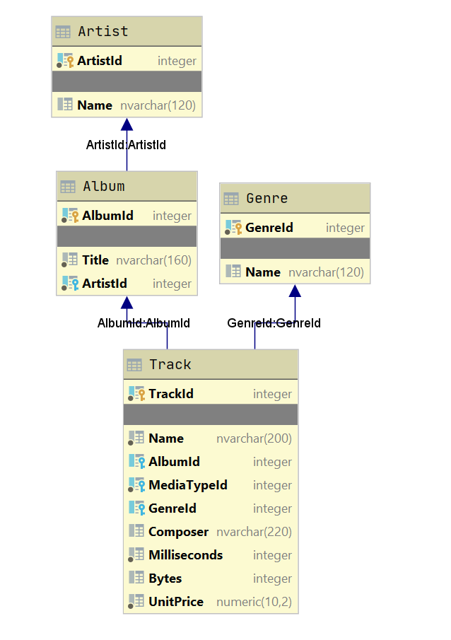

# Список песен

| Характеристика | Значение |
| --- | --- |
| **Категория** | Классная работа |
| **Макс. балл** | 16 |
| **Ограничение времени** | 1 секунда |
| **Ограничение памяти** | 64Mb |
| **Ввод** | стандартный ввод или input.txt |
| **Вывод** | стандартный вывод или output.txt |
| **ID задачи** | `89196` |

---

## Условие

В интернете достаточно много баз данных, которые свободно можно использовать в том числе для обучения программированию. [Одна из таких баз данных](https://github.com/lerocha/chinook-database) — база данных музыкального магазина. Там достаточно много таблиц, нас будут интересовать только вот эти: 

Вашему приложению доступна база данных **music\_db.sqlite**, в которой есть таблицы, соответствующие данной схеме.

Напишите программу, которая считывает имя исполнителя, и выводит все неповторяющиеся названия треков этого исполнителя, упорядоченные по алфавиту, каждый трек с новой строки.

## Формат ввода

Одна строка — название исполнителя.

## Формат вывода

Результат запроса — названия музыкальных треков, каждое с новой строки.

## Примечания

Названия таблиц и полей в базе данных не чувствительны к регистру, то есть "ArtistId" то же, что "artistid".
