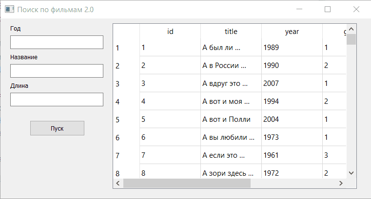

# Поиск по фильмам 2.0

| Характеристика | Значение |
| --- | --- |
| **Категория** | Дополнительные задачи |
| **Макс. балл** | 50 |
| **Ограничение времени** | 10 секунд |
| **Ограничение памяти** | 128Mb |
| **Ввод** | стандартный ввод или input.txt |
| **Вывод** | стандартный вывод или output.txt |
| **ID задачи** | `89306` |

---

## Условие

Модифицируйте программу «Поиск по фильмам» классной работы.

* Выводите все результаты поиска в таблицу (а не только первый найденный)
* Добавьте возможность вводить параметры запроса в формате SQL, например, `LIKE '%A' или >20`
* Добавьте вывод названий полей в шапке таблицы, в которой отображается информация о фильме. Названия полей должны получаться непосредственно из базы данных. Подсказка: обратите внимание на параметры курсора

Назовите главный класс программы **MyWidget**.

Поля для ввода года, названия и длины фильма назовите **year**, **title**, **duration** соответственно.

У кнопки должно быть название **queryButton**.

Таблицу для вывода информации о фильмах назовите **tableWidget**. В ней должны быть столбцы с **id**, **названием**, **годом выпуска**, **жанром** и **продолжительностью**.  
Используйте базу данных [films\_db.sqlite](./films_db.sqlite).
