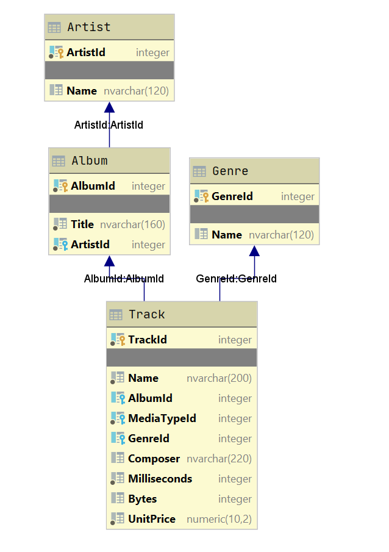

# Список исполнителей

| Характеристика | Значение |
| --- | --- |
| **Категория** | Дополнительные задачи |
| **Макс. балл** | 50 |
| **Ограничение времени** | 1 секунда |
| **Ограничение памяти** | 64Mb |
| **Ввод** | стандартный ввод или input.txt |
| **Вывод** | стандартный вывод или output.txt |
| **ID задачи** | `89323` |

---

## Условие

Опять нас ждет [база данных музыкального магазина](https://github.com/lerocha/chinook-database). Как и раньше, нас будут интересуют не все таблицы, а только вот эти: 

Вашему приложению доступна база данных **music\_db.sqlite**, в которой есть таблицы, соответствующие данной схеме.

Напишите программу, которая считывает название жанра, и выводит все имена исполнителей, у которых есть хотя бы один трек в этом жанре, упорядоченные по алфавиту, каждое название с новой строки.

## Формат ввода

Одна строка — название жанра.

## Формат вывода

Результат запроса — названия исполнителей, каждое с новой строки.

## Примечания

Названия таблиц и полей в базе данных не чувствительны к регистру, то есть "ArtistId" то же, что "artistid".

Если вам кажется, что запрос получается очень громоздкий, это действительно так :) Почитайте про оператор [JOIN](https://ru.wikipedia.org/wiki/Join_(SQL)) и попробуйте оптимизировать свой запрос.
