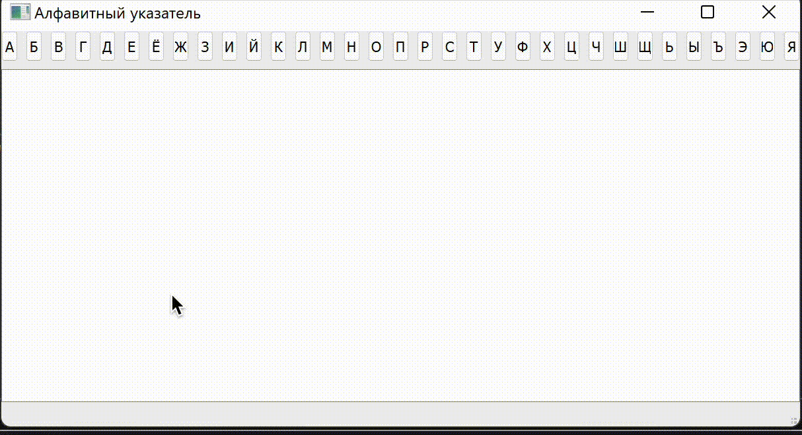

# Алфавитный указатель

| Характеристика | Значение |
| --- | --- |
| **Категория** | Домашняя работа |
| **Макс. балл** | 20 |
| **Ограничение времени** | 10 секунд |
| **Ограничение памяти** | 640 Мб |
| **Ввод** | стандартный ввод или input.txt |
| **Вывод** | стандартный вывод или output.txt |
| **ID задачи** | `89329` |

---

## Условие

Напишите программу с графическим пользовательским интерфейсом для отображения информации о фильмах с фильтрацией по алфавиту. Расположите на форме виджет-layout, содержащий кнопки (**QPushButton**) со всеми заглавными буквами русского алфавита. При нажатии на виджет с буквой должны отображаться фильмы, начинающиеся на эту букву. Дополнительно выводите количество фильмов в таблице (**QTableWidget**) после фильтрации, предусмотрите сообщение на случай, если ни одного фильма не найдено.

  
Назовите главный класс программы **MyWidget**.

Инициализируйте массив **buttons** как атрибут **MyWidget** и добавьте туда все кнопки в алфавитном порядке. Обработчик нажатия назначьте для каждой кнопки индивидуально.

Выводите в **statusBar** сообщение **Нашлось {n} записей** если в базе есть фильмы с такой первой буквой, или **К сожалению, ничего не нашлось**. Для этого используйте виджет **QStatusBar**, который уже есть в классе **QMainWindow**, он называется **statusbar**. Для получения доступа к этому виджету используйте метод **statusBar** класса **QMainWindow**.

Таблицу для вывода информации о фильмах назовите **tableWidget**. В ней должны быть столбцы: **ID**, **Название**, **Год**, **Жанр**, **Продолжительность**.  
Используйте базу данных [films\_db.sqlite](./films_db.sqlite).
