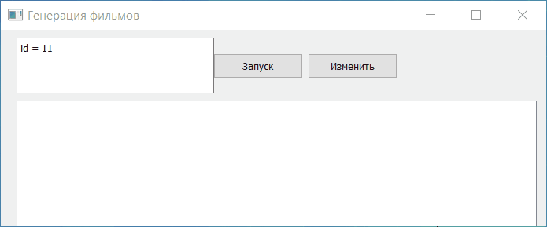

# Генерация фильмов

| Характеристика | Значение |
| --- | --- |
| **Категория** | Классная работа |
| **Макс. балл** | 20 |
| **Ограничение времени** | 10 секунд |
| **Ограничение памяти** | 64Mb |
| **Ввод** | стандартный ввод или input.txt |
| **Вывод** | стандартный вывод или output.txt |
| **ID задачи** | `89122` |

---

## Условие

Модифицируйте программу, рассмотренную в материалах урока, таким образом, чтобы по заданному индексу после просмотра элемент удалялся, и создавался новый по следующему правилу:

1. Название нового элемента — это перевёрнутое старое название
2. Год выпуска — соответствующий год следующего тысячелетия
3. Жанр не меняется
4. Продолжительность увеличивается в 2 раза

Также предусмотрите случаи, когда по заданному запросу не будет найдено записей в базе (необходимо сообщить об этом пользователю и избежать завершения программы).

**Руководство к решению:**  
Класс, реализующий окно приложения, назовите **MyWidget**. Поле, находящееся в левом верхнем углу, для составления запроса обозначьте как **textEdit**. Кнопки "Запуск" и "Изменить" именуйте **pushButton** и **saveButton** соответственно. Таблицу в которой будут отображаться результаты поиска назовите **tableWidget**. Всплывающее окно с подтверждением изменений следует делать через **QMessageBox**. С помощью **QStatusBar** реализуйте вывод сообщения об отсутствии записей в БД, это поле необходимо назвать **statusbar** (если нет записей по данному запросу отобразите сообщение "По этому запросу ничего не найдено", иначе замените его на пустую сторку).
