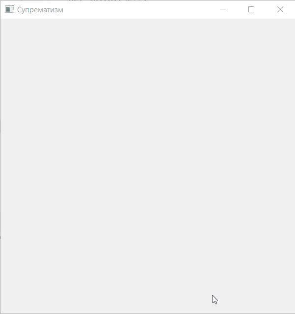

# Супрематизм

| Характеристика | Значение |
| --- | --- |
| **Категория** | Классная работа |
| **Макс. балл** | 33 |
| **Ограничение времени** | 1 секунда |
| **Ограничение памяти** | 64Mb |
| **Ввод** | стандартный ввод или input.txt |
| **Вывод** | стандартный вывод или output.txt |
| **ID задачи** | `88862` |

---

## Условие

Напишите программу с графическим пользовательским интерфейсом на PyQT, которая будет обладать следующей функциональностью:

После запуска программы отображается форма размером 1000 пикселей по обоим измерениям. При нажатии левой кнопкой мыши на форме рисуется круг случайного размера и случайного цвета в точке, в которой находится курсор. При нажатии правой — квадрат случайного размера и цвета. Если была нажата клавиша «Пробел» — там, где располагается курсор, должен появиться треугольник также случайного размера и цвета. Рисунки не должны сохраняться.

Радиус окружности должен быть в диапазоне [20, 100] пикселей, сторона квадрата аналогично. Их центром должна быть точка нажатия

Треугольник должен быть равносторонним и вписанным в окружность с центром в точке нажатия и радиусом в диапазоне [20, 100] пикселей. Одна из его сторон должна располагаться параллельно оси x, а третья точка (не принадлежащая этой стороне) должна быть выше остальных (как на видео)

Генерировать цвета обязательно с помощью **random.randint**. Для получения одного случайного цвета обязательно сгенерировать по 3 числа, отвечающие за r, g и b каналы

Для каждой фигуры сначала сгенерируйте число в диапазоне от 20 до 100, а уже потом цвет

Класс, реализующий окно приложения, назовите **Suprematism**.  
Все вычисления производите в вещественных числах без округлений.  
Для изображения окружности используйте метод [**drawEllipse**](https://doc.qt.io/qtforpython-6/PySide6/QtGui/QPainter.html#PySide6.QtGui.QPainter.drawEllipse) класса [**QPainter**](https://doc.qt.io/qtforpython-6/PySide6/QtGui/QPainter.html#PySide6.QtGui.QPainter) с сигнатурой `drawEllipse(center:QPointF, rx:float, ry:float)`.  
Для изображения квадрата воспользуйтесь методом [**drawRect**](https://doc.qt.io/qtforpython-6/PySide6/QtGui/QPainter.html#PySide6.QtGui.QPainter.drawRect) класса [**QPainter**](https://doc.qt.io/qtforpython-6/PySide6/QtGui/QPainter.html#PySide6.QtGui.QPainter). Для создания объекта прямоугольника, который передается методу **drawRect**, используйте класс [**QRectF**](https://doc.qt.io/qtforpython-6/PySide6/QtCore/QRectF.html#PySide6.QtCore.QRectF).  
Для создания объекта треугольника, который передается методу [**drawPolygon**](https://doc.qt.io/qtforpython-6/PySide6/QtGui/QPainter.html#PySide6.QtGui.QPainter.drawPolygon), используйте класс [**QPolygonF**](https://doc.qt.io/qtforpython-6/PySide6/QtGui/QPolygonF.html#PySide6.QtGui.QPolygonF). Для добавления точек в треугольник используйте в конструктор класса метод **QPolygonF** передавайте список (list) точек класса [**QPointF**](https://doc.qt.io/qtforpython-6/PySide6/QtCore/QPointF.html#PySide6.QtCore.QPointF). Все вычисления производите в вещественных числах, вещественные результаты вычислений передавайте конструктору класса [**QPointF**](https://doc.qt.io/qtforpython-6/PySide6/QtCore/QPointF.html#PySide6.QtCore.QPointF) - это точки - вершины треугольника.
