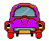

# Машинка

| Характеристика | Значение |
| --- | --- |
| **Категория** | Классная работа |
| **Макс. балл** | 33 |
| **Ограничение времени** | 10 секунд |
| **Ограничение памяти** | 64Mb |
| **Ввод** | стандартный ввод или input.txt |
| **Вывод** | стандартный вывод или output.txt |
| **ID задачи** | `88935` |

---

## Условие

Используя виджеты PyQT, напишите игру «Машинка». Изображение машинки должно двигаться за мышкой по форме приложения. Если во время игры была нажата клавиша «пробел», изображение меняется на другую картинку. При приближении курсора мыши к краю окна изображение машинки должно не исчезать, а останавливаться у границы.

Класс, реализующий окно приложения, назовите **Car**.

Всего должно быть три изображения с названиями 'car1.png', 'car2.png', ' car3.png', начинать нужно с первого и менять по кругу (после car3 должно быть car1)

Само изображение в формате QPixmap нужно сохранить в атрибуте **pixmap** объекта класса приложения, потом изображение поместить в QLabel с именем **lbl**

Размер окна должен быть 300x300  
 "Краем" окна считаем координату 250 (включительно) по обеим осям. Если курсор мыши заходит за "край" окна, то изображение машинки должно оставаться на месте. Примеры машинок:  
   
   
 
