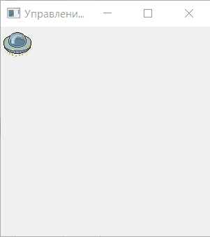

# Управление НЛО

| Характеристика | Значение |
| --- | --- |
| **Категория** | Домашняя работа |
| **Макс. балл** | 33 |
| **Ограничение времени** | 10 секунд |
| **Ограничение памяти** | 64Mb |
| **Ввод** | стандартный ввод или input.txt |
| **Вывод** | стандартный вывод или output.txt |
| **ID задачи** | `89129` |

---

## Условие

Напишите программу «Управление НЛО» с использованием виджетов PyQT. Пользователь должен иметь возможность управлять движением НЛО с помощью клавиш-стрелок на клавиатуре. Нажатие кнопки изменяет положение по одной из координатных осей на 10 пикселей. Координаты НЛО по осям x и y должны находиться в диапазоне от 0 до 250 пикселей включительно. В случае выхода за эти пределы НЛО должно появляться с другой стороны.

Вашему решению будет доступен файл **ufo.png** с картинкой НЛО. Отображение НЛО реализуйте через **Qlabel**, который должен называться **ufo** и иметь **QPixmap** с данной картинкой. Размер окна: 300 пикселей в ширину и в высоту.  
Файл с картинкой:  

Класс, реализующий окно приложения назовите **UfoControl**

